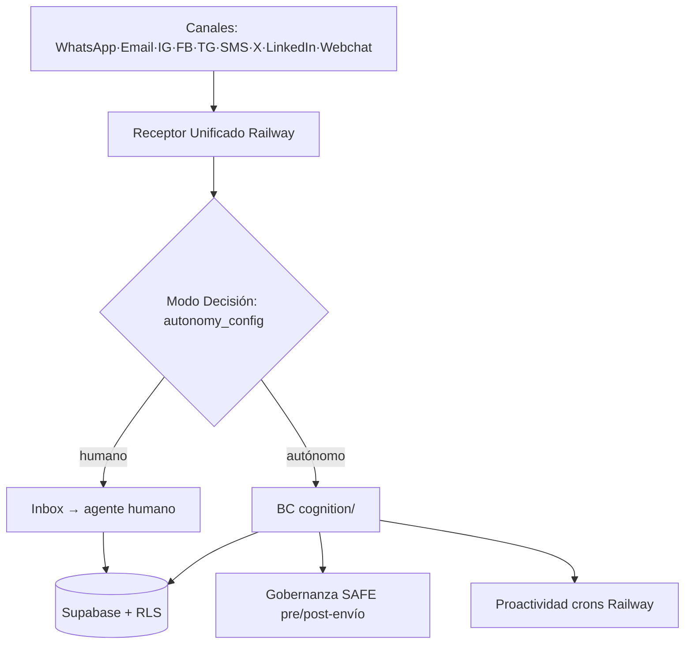

# Arquitectura — Diagrama del Agent Service

## Vista end-to-end

## Componentes críticos
1. **Receptor unificado** — normaliza mensaje: tenant, canal, contacto, texto, adjuntos, contexto.
2. **Modo decisión** — ¿canal/horario/tipo configurado para autonomía o humano?
3. **BC cognition/** — memoria (interactions/knowledge/episodes/graph) + razonamiento (Claude) + acción (RPCs/Zernio/Resend).
4. **Gobernanza SAFE** — pre-envío síncrono (acciones críticas) + post-envío sampling 10%.
5. **Proactividad** — crons: sin-respuesta (hora), reporte diario, auto-regeneración (dom 11PM), reporte semanal.

## Bus de eventos
Supabase Realtime (no REST punto a punto). Ver `domain/*/eventos`.
